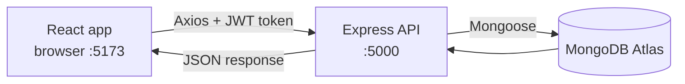
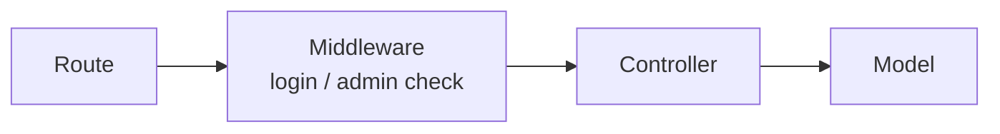
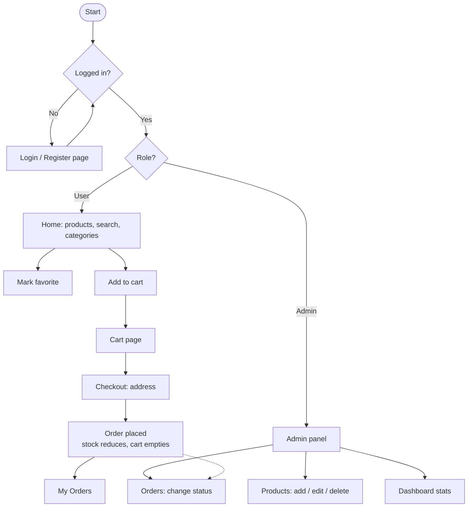

# Shop App (MERN)

A full-stack online shopping app built with **MongoDB, Express, React and Node.js**.
Customers can register, log in, browse products, save favorites, add items to a cart and place orders.
The shopkeeper (admin) can add products with price and stock, and manage orders from an admin panel.

> Built as a learning project to understand how the frontend, backend and database work together.

---

## Goal

Build an industry-style shopping app step by step and learn:

- how React (frontend) talks to Express (backend) using an API
- how login works with JWT tokens
- how data is stored in MongoDB
- how an admin panel and a customer shop work in the same app

---

## Tech Stack

| Part | Technology |
|------|------------|
| Frontend | React 19, Vite, Tailwind CSS v4, React Router, Axios |
| Backend | Node.js, Express 5, Mongoose |
| Database | MongoDB Atlas |
| Auth | JWT (JSON Web Token), bcryptjs for password hashing |
| Tools | VS Code, Git, GitHub, PowerShell |

---

## Features

### Customer
- Register and log in
- Menu with categories (Men, Women, Kids & Baby) and a search bar (shown after login)
- Product list with filter by category and search
- Favorites (heart button), shown in the account panel
- Cart: add, change quantity, remove (backend ready)
- Checkout and place order (backend ready)
- My Orders (backend ready)

### Admin (shopkeeper)
- Dashboard: revenue, total orders, pending orders, low stock
- Products: add, edit, delete (name, category, price, stock, image)
- Orders: see all orders and change status (pending, processing, shipped, delivered, cancelled)

---

## How It Works



Backend pattern for every feature:



---

## Project Flow



---

## Folder Structure

```
shop-app1/
├── backend/
│   ├── server.js            starts the server and connects the database
│   ├── makeAdmin.js         helper: node makeAdmin.js email  (makes a user admin)
│   └── src/
│       ├── app.js           Express app and routes
│       ├── config/db.js     MongoDB connection
│       ├── models/          User, Product, Cart, Order
│       ├── controllers/     auth, product, cart, order, wishlist
│       ├── routes/          /api/auth, /api/products, /api/cart, /api/orders, /api/wishlist
│       ├── middleware/      auth.js (protect), admin.js (admin only)
│       └── utils/           generateToken.js
└── frontend/
    └── src/
        ├── main.jsx
        ├── App.jsx          navbar and routes
        ├── api/axios.js     adds the JWT to every request
        ├── context/AuthContext.jsx
        ├── components/      AdminRoute.jsx, UserPanel.jsx
        ├── pages/           Home, Login, Register
        └── admin/           AdminLayout, Dashboard, Products, Orders
```

---

## API List

| Method and URL | Who | What it does |
|----------------|-----|--------------|
| POST /api/auth/register | Anyone | Create an account |
| POST /api/auth/login | Anyone | Log in, returns a token |
| GET /api/auth/me | Logged in | Current user |
| GET /api/products | Anyone | List products (`?search=` and `?category=`) |
| GET /api/products/:id | Anyone | One product |
| POST, PUT, DELETE /api/products | Admin | Manage products |
| GET /api/cart | Logged in | My cart |
| POST /api/cart | Logged in | Add item (checks stock) |
| PUT /api/cart/:productId | Logged in | Change quantity |
| DELETE /api/cart/:productId | Logged in | Remove item |
| POST /api/orders | Logged in | Create order from cart, reduce stock |
| GET /api/orders/my | Logged in | My orders |
| GET /api/orders | Admin | All orders |
| PUT /api/orders/:id/status | Admin | Change order status |
| GET /api/wishlist | Logged in | My favorites |
| POST /api/wishlist/:productId | Logged in | Save or remove a favorite |

---

## Run It On Your Computer

You need Node.js and a MongoDB Atlas database.

**1. Backend**

```bash
cd backend
npm install
```

Create a file `backend/.env` with:

```
MONGO_URI=your_mongodb_connection_string
JWT_SECRET=a_long_random_secret
PORT=5000
```

Start it:

```bash
npm run dev
```

**2. Frontend**

```bash
cd frontend
npm install
```

Create a file `frontend/.env` with:

```
VITE_API_URL=http://localhost:5000/api
```

Start it:

```bash
npm run dev
```

Open `http://localhost:5173`.

**3. Make an admin**

Register once on the website, then run in the `backend` folder:

```bash
node makeAdmin.js your-email@example.com
```

Log out and log in again. The **Admin** link will show next to your avatar.

---

## What I Did Today (8 Nov 2026)

- Made my user an admin with `makeAdmin.js` (fixed the wrong `./models/User` path to `./src/models/User`)
- Hid the Menu and search bar for logged-out visitors; added `PrivateRoute` so guests go to the Login page
- Reviewed the admin panel files (AdminLayout, Dashboard, Products, Orders)
- Planned a category dropdown in the admin product form so categories match the shop menu
- Learned how to view my data in MongoDB Atlas (Browse Collections)
- Created a `.gitignore` and pushed the project to GitHub

---

## Current Status

| Area | Status |
|------|--------|
| Database connection, Auth, Admin guard | Working |
| Products, Cart, Orders, Wishlist APIs | Working and tested |
| Login, Register, Home, Navbar, Admin panel | Written, being tested |
| Cart, Checkout, My Orders pages | Not built yet |

---

## Roadmap

1. Build the Cart, Checkout and My Orders pages
2. Payment with Razorpay (test mode first)
3. Order confirmation email (Nodemailer)
4. Real-time order popup (Socket.io)
5. Product image upload (Cloudinary)
6. Polish: product details page, loading and error states, mobile layout
7. Security: input validation, login rate limiting, strong JWT secret, restrict Atlas IP access
8. Deploy: backend on Render or Railway, frontend on Vercel or Netlify

---

## Security Notes

- Never commit `.env`. It is listed in `.gitignore`.
- Use a long random `JWT_SECRET`.
- Before going live, allow only the hosting server in the Atlas IP list.

---

## Author

**Dhananjay Sharma** - [GitHub](https://github.com/dhananjayshrama)
